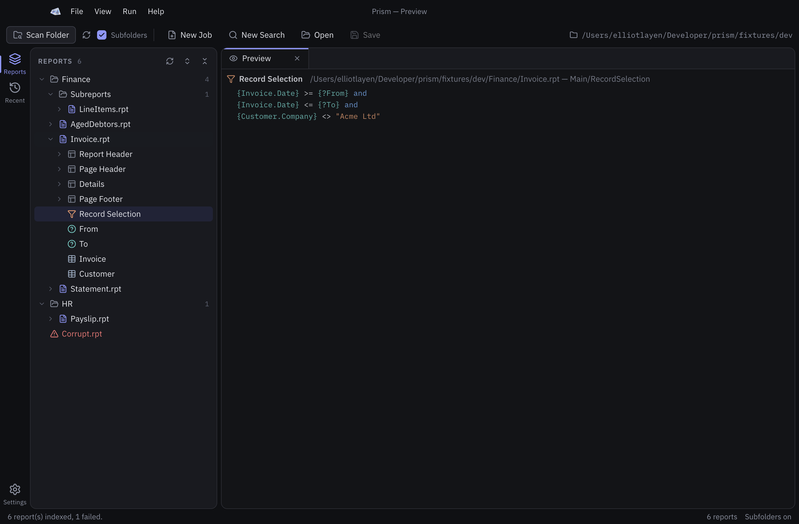
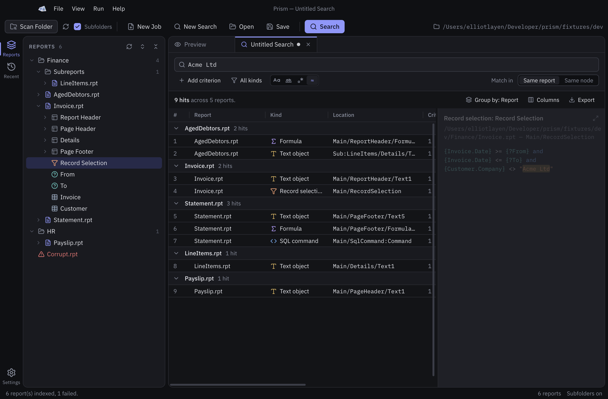
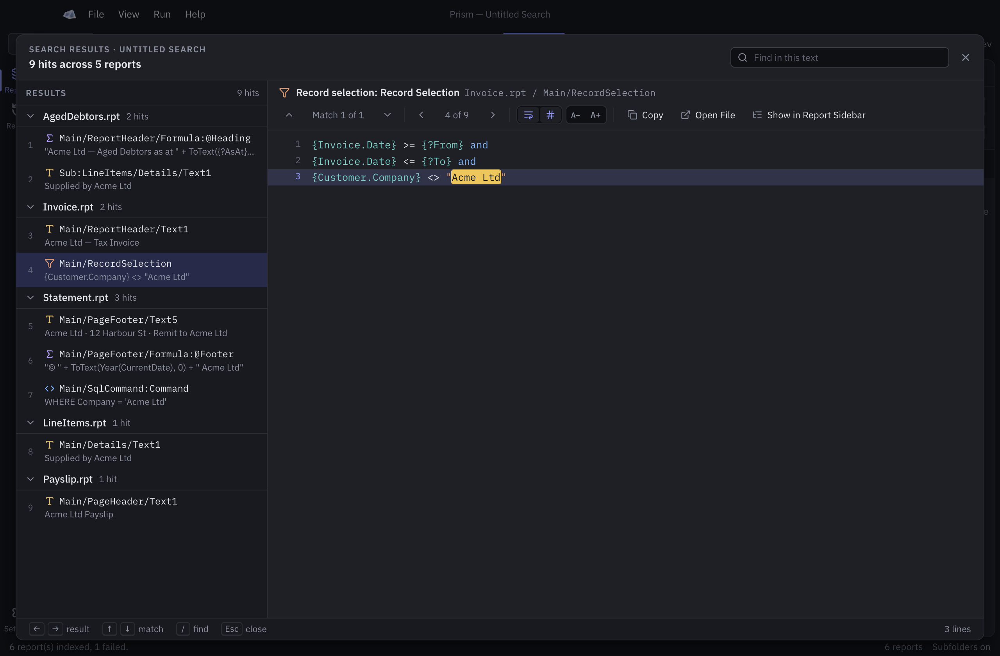
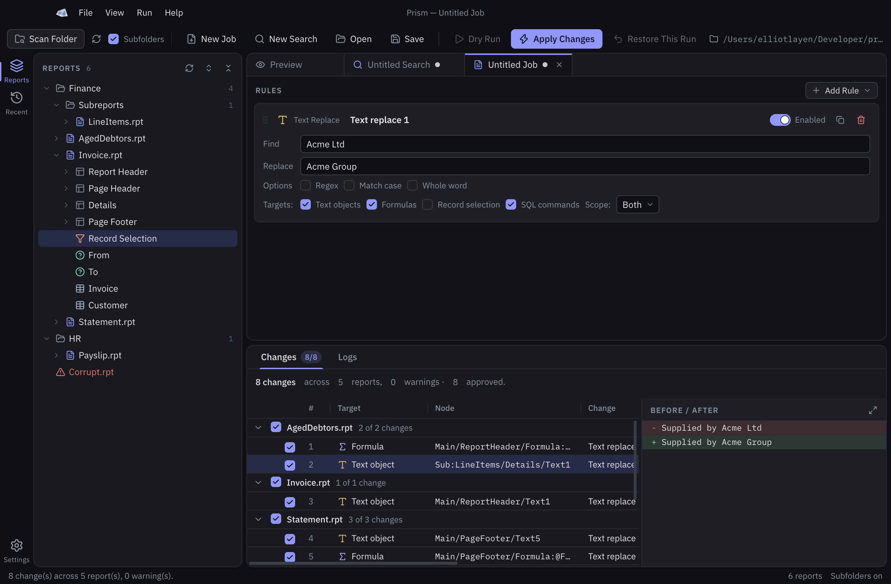
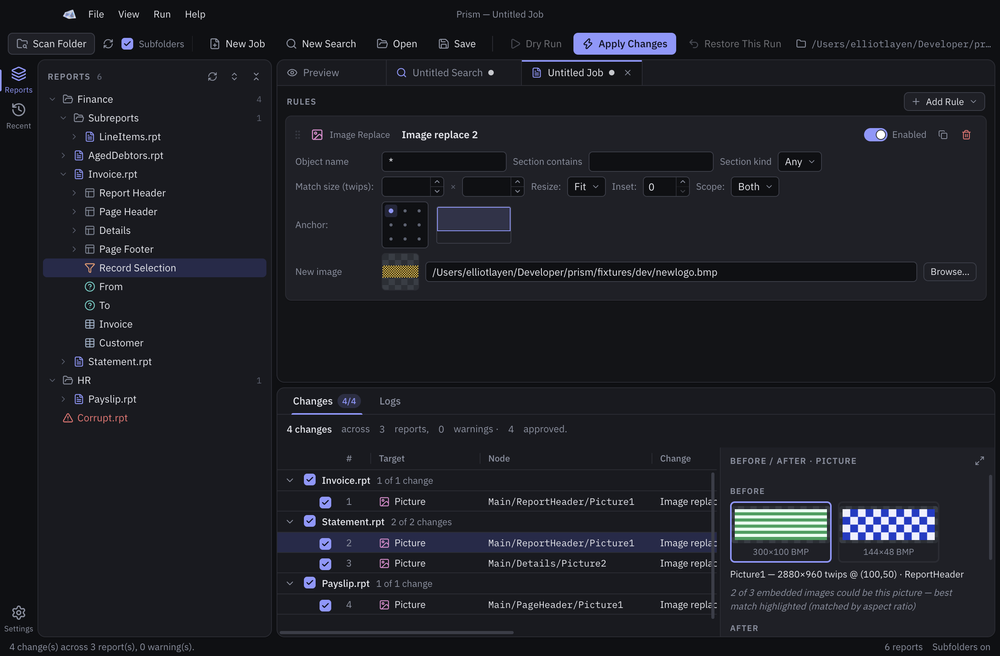
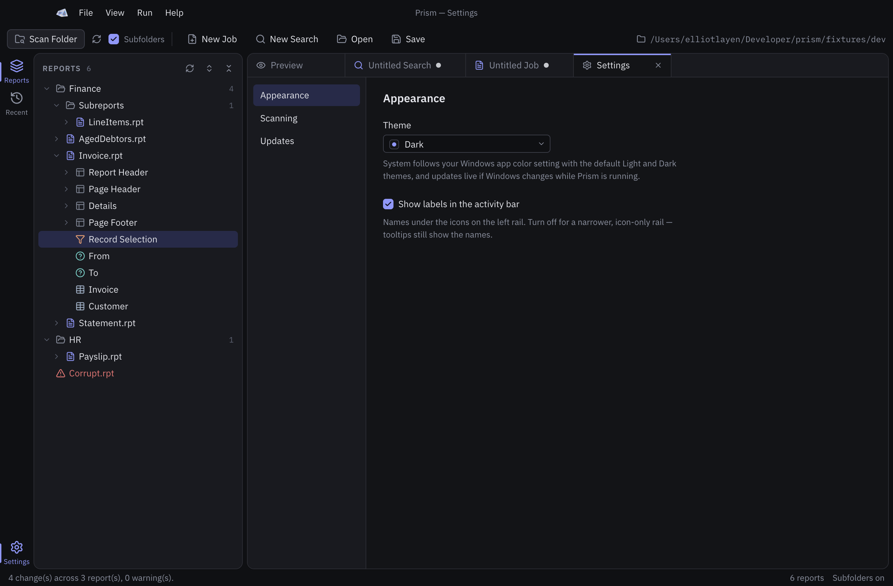

  

<h1 align="center">Prism</h1>

<strong>Find and mass-edit Crystal Reports safely.</strong> 
Search every text object, formula, SQL command, parameter and name across ten or a thousand <code>.rpt</code> files in one go — then change what you found in one run, with a full preview first, a backup of every original, and a one-click way back.

  <a href="../../releases/latest"><strong>Download the latest release →</strong></a>

---

## Why Prism

Which reports still carry the old company name? Which formulas use `{?From}`? Which SQL commands join the `Orders` table, and which text objects print a field that is about to be renamed? Answering any of that means opening every report in the Designer, one after another, and looking. Prism indexes the whole folder once and answers in a second: every criterion runs against everything it indexed, the hits group by report, kind or location, and each one opens to its full text with the matches highlighted.

Renaming that company, swapping a logo, retargeting a parameter or fixing a formula across the same folder means opening every report again and making the same edit over and over. Prism does the edit once, as a rule, and applies it to every report that matches — but only after it has shown you exactly what would change, report by report and line by line, and only to the changes you tick.

Under the hood, Prism edits reports through the Crystal Reports SDK itself, so what it saves is what the Designer would have saved. Text objects are edited at the paragraph level, which means a sentence that mixes typed text with embedded database fields keeps its fields live — the one thing a plain find-and-replace on report text gets wrong. Searching never opens a report in the engine at all: it reads the index from the last scan, so it is fast and cannot touch a file.

## What it does

**Finding**

- **Scan and explore.** Point Prism at a folder (subfolders included) and it indexes every report: sections, text objects, fields, formulas, record selection, parameters, SQL commands, pictures, groups and subreports. Click anything for a syntax-coloured preview. `Ctrl+K` jumps to any report or node by name.
- **Search everything indexed.** One search runs across the names and contents of text objects, formulas, record selection and SQL commands, the prompts of parameters, the data source of every field, the condition field of every group, and the names of tables, sections, reports and subreports — in every report at once.
- **Combine and tune.** Add as many criteria as you like, joined with And / Or. Require them all in the same report or in the very same formula, SQL command or object. Limit the search to the kinds of object you care about. Match case, whole words, regular expressions, or loose matching that ignores spacing differences.
- **Read, jump, export.** Results group by report, kind, location or criterion and sort by any column. Select a hit to see its full text with every criterion highlighted, or expand to a reading view that steps through matches. Jump from any hit to the node in the sidebar, open the report itself, or export the lot to CSV, JSON or plain text.
- **Searches are documents.** A search saves to a file you can share and reopens from Recent or `Ctrl+O`, exactly like a job. The file holds the criteria and options, not the results, so it runs again against whatever folder is scanned.

**Changing**

- **Jobs made of rules.** Nine rule kinds, each a small form on a card. Rules validate as you type, duplicate with one click and reorder by drag. Jobs save to a file you can share.
- **Dry run before anything changes.** Every planned change with a Before / After diff, picture changes with the actual image and its placement, warnings where a change needs a look, and a summary per report.
- **Approve what you mean.** Every change has its own tick; a report's tick covers all of its changes. The confirm tells you exactly how many changes in how many reports will be applied.
- **Apply with a safety net.** Every original is backed up before it is touched, every report is journaled as it is edited, and an audit log records what happened. **Restore This Run** puts the originals back byte for byte.
- **Nothing takes the window down.** The Crystal engine runs as a separate process. If it ever fails mid-run, Prism comes back in recovery mode and offers the restore before anything else; outside a run it simply restarts the engine.

## What a search can do

A search is one or more criteria, a choice of where they must agree, a filter on kinds, and four match options that apply to every criterion.

**Match options**

| Option | What it does |
|---|---|
| **Case sensitive** | Off by default: `acme` finds `ACME`. |
| **Whole word** | `Ltd` matches `Acme Ltd` but not `Ltdx`. |
| **Regular expression** | .NET regex syntax. Loose match is ignored in this mode. |
| **Loose match** | On by default. Spacing is flexible around punctuation, so `COUNT(x)` finds `COUNT (x)` and `a>1` finds `a > 1`. Paste a whole SQL definition and formatting differences will not hide the match. |

**Match in**

| Choice | A report counts when… |
|---|---|
| **Same report** (default) | every criterion hits somewhere in it — one in a formula, another in the SQL, a third in a text object. |
| **Same node** | every criterion hits the same formula, SQL command or object. |

Criteria joined with **And** must all hit; **Or** accepts either side. They combine left to right, so *A and B or C* reads as *(A and B) or C*.

**What is searched**

Every node is searched by name. These kinds are also searched by their contents:

| Kind | Also searched |
|---|---|
| **Text objects** | The text, with embedded fields shown as `{Customer.Name}` |
| **Formulas** | The formula text |
| **Record selection** | The selection formula |
| **SQL commands** | The SQL |
| **Parameters** | The prompt text |
| **Field bindings** | The database field each one points at |
| **Groups** | The field the group is based on |
| **Tables & views** | The location, and the original name if the table was renamed |
| **Sections**, **report & subreport names**, **other objects** (pictures, lines, boxes, charts, cross-tabs) | The name only |

The kind filter narrows the whole search: a criterion that only hits an excluded kind does not count.

## A search, start to finish

1. **Run → Scan Folder…** and choose the folder of reports. Subfolders are included. A search needs a scan first; it runs against the index, never the reports themselves.
2. **File → New Search** (`Ctrl+F`) and type the first criterion. **Add criterion** for more, pick And / Or between them, choose **Match in** and, if you want, which kinds to search.
3. **`Ctrl+Enter`**, or the **Search** button. The summary line reads *9 hits across 5 reports*.
4. Read the results. **Group by** report, kind, location or criterion; click a column to sort; choose the columns you want. Select a hit and its full text appears beside the list with every criterion highlighted.
5. **Expand** for the reading view: step through matches with `↑` `↓` and results with `←` `→`, type `/` to find within the text, toggle wrapping and line numbers, or copy the whole text.
6. Right-click a hit for **Show in Report Sidebar**, which opens the tree to that node, or **Open File**, which opens the report in its default application.
7. **Export…** writes the results as CSV, JSON or plain text. Choose the fields: report, path, kind, location, criterion, hit count, the match snippet, or the full formula or SQL command each hit matched in.
8. **File → Save** keeps the search as a `.prism-search.json` you can reopen or share.

## The nine rule kinds

| Rule | What it changes |
|---|---|
| **Text replace** | Text objects (and optionally formulas and SQL commands). Embedded fields are kept intact; a match that would touch one is reported, not applied. |
| **Formula edit** | The text of formula fields, by name match. |
| **Record selection** | The report's record-selection formula. |
| **Image replace** | Pictures, matched by name, section or size, replaced with your file, with a choice of stretch, fit or natural size and a 3×3 anchor. |
| **Parameter edit** | Rename a parameter — every formula, selection and text field that uses it follows — or change its prompt. |
| **Field swap** | Point field objects, text fields, formulas and selection at a different database field. |
| **SQL command** | The SQL of a command object. |
| **Section format** | Suppress, keep-together and page-break flags on sections. |
| **Group field** | The field a group is based on. |

## A job, start to finish

1. **Run → Scan Folder…** and choose the folder of reports. Subfolders are included.
2. **File → New Job** (`Ctrl+N`), then **Add Rule** for each edit. Fill in the card; problems are marked on the field they concern.
3. **Dry Run** (`F5`). Read the Changes tab: select a change to see its Before / After, step through with the arrow keys, or expand the pane for a full-size view. Warnings explain anything Prism will not do by itself.
4. Untick anything you do not want. The report row's tick covers the whole report.
5. **Apply Changes.** Confirm the count. Progress shows per report; Cancel stops between reports.
6. The **Logs** tab lists the outcome per report, the backup folder and the audit file. **Restore This Run** undoes it.
7. **File → Save** keeps the job as a `.prism-job.json` for next time.

## Results, in detail

- A search runs over the index in memory. It never opens a report in the Crystal engine, so it cannot change a file, and it is not available until a scan has finished. After the engine restarts, scan again before searching; the criteria you typed are kept.
- Rescanning the folder clears the results. Search again to see them against the fresh index.
- The list shows the first 5,000 hits; the summary says so when there are more. Export writes every hit, up to 50,000.
- A regular expression that takes too long on one item is skipped for that item rather than stalling the search. An invalid pattern is reported against its criterion.
- Column layout and the reading view's wrap, line-number and size choices are remembered across searches.

## Safety, in detail

- Order per report: **backup → open → change → save to a temporary file → close → swap**. A report is never replaced unless its new version saved cleanly.
- Every planned change re-checks the live value against what the dry run saw. If a report changed on disk in between, the change is skipped as *drifted* and reported — never guessed.
- Formulas are validated after editing; an edit that would break a formula blocks the save of that report.
- Backups live in a `.prism-backup` folder beside the reports, one dated folder per run, mirroring the folder structure, with the audit log inside.
- If the engine process dies in the middle of a run, Prism restarts in recovery mode: the interrupted run is listed with the report it was on, and Restore puts every touched report back, that one included.

## Install

**Requirements**

- Windows 10 or 11, 64-bit.
- The **SAP Crystal Reports runtime for .NET Framework, 32-bit, version 13.0.x** (the runtime that ships with Crystal Reports 2013; a machine with the Designer installed already has it).
- .NET Framework 4.7.2 or newer, which is part of Windows 10 and 11.

**Steps**

1. Download `Prism-Setup-<version>.exe` from the [latest release](../../releases/latest).
2. Run it. It installs for the current user only — no administrator rights needed.
3. Windows SmartScreen will warn that the publisher is unknown, because the installer is not code-signed. Choose **More info → Run anyway**. This happens once; updates install silently.

**Updates** are automatic. Prism checks for a new version shortly after it starts and every few hours, downloads it in the background, and shows **Restart to update** in the status bar when it is ready. If you do not restart, the update installs the next time you quit. An update is never installed while changes are being applied. Settings → Updates turns the automatic check off; Help → Check for Updates… works either way, and About → Release notes shows what changed.

## Keyboard

| Keys | Action |
|---|---|
| `Ctrl+Shift+O` | Scan a folder |
| `Ctrl+F` | New search — or, with a search already open, jump to its first criterion |
| `Ctrl+Enter` | Run the search (from a criterion box) |
| `Ctrl+N` | New job |
| `F5` | Dry run |
| `Ctrl+O` | Open a job or search |
| `Ctrl+S` / `Ctrl+Shift+S` | Save / Save As |
| `Ctrl+W` | Close the document |
| `Ctrl+K` | Command palette — every command, plus jump to any report or node |
| `Ctrl+B` | Toggle the sidebar |
| `Ctrl+,` | Settings |

## Reporting a problem or asking for something

**Help → Report an Issue…** in the app opens this repository's issue tracker, or go straight to [New issue](../../issues/new/choose). There are templates for a bug report and for an enhancement request. For a bug, include the version from **Help → About Prism** and, if you can, the relevant lines from the log: **Help → Open Logs Folder** opens the folder; `prism.log` records every engine start, run and error.

## Versions

Versions are `YYYY.major.minor`: the year, a number that goes up for major releases, and one that goes up for fixes and small improvements. Every release on the [releases page](../../releases) lists what changed.

---

Created by Elliot Layen

